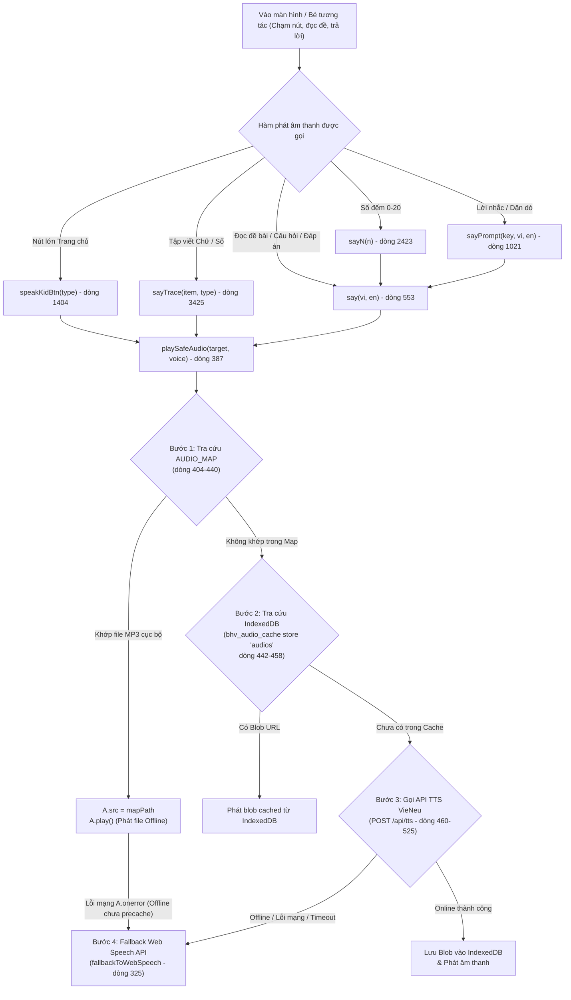

# Báo Cáo Kiểm Kê & Phân Tích Toàn Diện Hệ Thống Âm Thanh Trang Chủ & Chặng 0–1 (Task P2-07)

> **Mục tiêu**: Đo lường, truy vết mã nguồn và kiểm kê toàn bộ nguồn phát âm thanh ở Trang chủ và các bài học Chặng 0–1 (thuộc đối tượng bé 4 tuổi mầm non), phân loại chính xác thành 3 nhóm (đã precache / có file nhưng chưa precache / chưa có file phải dùng TTS-WebSpeech), làm rõ trường hợp âm tiết "bã" (`syl_b_a_4.mp3`) và sự cố trượt map do ký tự Emoji.
> **Nguyên tắc**: Tuyệt đối không đoán; mọi kết luận đều có dẫn chứng hàm, số dòng trong mã nguồn và lệnh đo thực tế trên hệ thống file.

---

## 1. Cơ Chế Chuyển Đổi Câu Chữ Thành File Audio (Codebase Walkthrough)

Dựa trên việc đọc trực tiếp mã nguồn [`app.js`](file:///d:/Nghia/Python/My-Little-Girls-Game/app.js) và [`audio-map.js`](file:///d:/Nghia/Python/My-Little-Girls-Game/audio-map.js), luồng xử lý âm thanh trong toàn bộ ứng dụng diễn ra như sau:



### 1.1. Các hàm khởi tạo yêu cầu phát âm thanh

| Tên hàm | Vị trí trong `app.js` | Cơ chế hoạt động |
| :--- | :--- | :--- |
| `speakKidBtn(type)` | Dòng 1404–1416 | Phát trực tiếp đường dẫn file MP3 khi bé chạm vào 3 nút lớn ở Trang chủ (`today` $\rightarrow$ `audio/ui_home_btn_today.mp3`, `games` $\rightarrow$ `audio/ui_home_btn_games.mp3`, `stickers` $\rightarrow$ `audio/ui_home_btn_stickers.mp3`). Khống chế debounce 600ms chống spam chạm. |
| `say(vi, en)` | Dòng 553–590 | Hàm trung tâm tiếp nhận chuỗi tiếng Việt và tiếng Anh. Khi `SOUND_ON()` bật và ngôn ngữ là `vi`, gọi `playSafeAudio(vi, "Tưởng Vy")`. Tự động ngắt phát âm cũ (`A.pause()`, `SS.cancel()`) trước khi phát câu mới. |
| `sayPrompt(key, vi, en, cd)` | Dòng 1021–1027 | Bộ điều khiển lời nhắc có thời gian chờ (cooldown `cd = 180000ms` / 3 phút) để tránh nhắc đi nhắc lại khi bé đứng ở một màn hình. Chuyển tiếp tới `say(vi, en)`. |
| `sayN(n)` | Dòng 2423 | `n => say(NV[n], NE[n])` với `NV` là mảng 21 từ tiếng Việt `["không", "một", ..., "mười chín", "hai mươi"]` (dòng 17). |
| `sayTrace(item, type)` | Dòng 3425–3488 | Phát âm khi bé luyện nét: nếu là `letter`, tra từ điển `alphaMap` lấy file `audio/alpha_vi_*.mp3`; nếu là `number`, tra `numMap` (0–10) lấy `audio/vi_*` hoặc fallback sang `sayN(+n)` cho số 11–20. |
| `getAudio(ak)` | Dòng 346–385 | Hàm trợ giúp bóc tách tiền tố ngôn ngữ `vi\|`, kiểm tra `REC`, và tìm kiếm trong `window.AUDIO_MAP`. |

---

### 1.2. Cơ chế 4 bước trong `playSafeAudio(text, voice, onEnd)` (Dòng 387–550)

Hàm cốt lõi quyết định một đoạn văn bản được phát bằng cách nào:

1. **Chuẩn hóa chuỗi đầu vào (Dòng 400–402)**:
   - `rawText = String(text).trim()`
   - `nk = typeof window.__normAudioKey === "function" ? window.__normAudioKey(rawText) : rawText.toLowerCase().trim()`
   - `cleanKey = nk.replace(/^(vi|en)\|/, "")`
2. **Bước 1: Tra cứu bản đồ `window.AUDIO_MAP` (Dòng 404–440)**:
   - Nếu `rawText` là đường dẫn trực tiếp (`audio/...mp3`, `blob:...`, `data:...`, `http...`) $\rightarrow$ phát ngay.
   - Nếu là chữ, tra cứu lần lượt qua 5 khóa:
     1. `window.AUDIO_MAP[rawText]` (khóa gốc)
     2. `window.AUDIO_MAP[nk]` (khóa đã qua `normKey`)
     3. `window.AUDIO_MAP[cleanKey]` (khóa bỏ tiền tố ngôn ngữ)
     4. `window.AUDIO_MAP["vi|" + cleanKey]` (khóa gắn tiền tố tiếng Việt)
     5. `window.AUDIO_MAP["en|" + cleanKey]` (khóa gắn tiền tố tiếng Anh)
   - Khi tìm thấy file local (`mapPath`): gán `A.src = mapPath` và gọi `A.play()`.
   - **Xử lý sự cố mạng khi Offline**: Nếu file MP3 cục bộ **chưa được precache trong Service Worker**, trình duyệt kích hoạt sự kiện `A.onerror` (dòng 424–427), lập tức chuyển thẳng sang `fallbackToWebSpeech(cleanKey, "vi-VN", finishOnce)` chứ không bị treo.
3. **Bước 2: Tra cứu bộ nhớ đệm IndexedDB (Dòng 442–458)**:
   - Mở cơ sở dữ liệu `bhv_audio_cache` (store `audios`).
   - Tìm kiếm theo khóa `tts:cleanKey` hoặc `rawText`. Nếu tìm thấy Blob URL đã tải trước đó $\rightarrow$ phát ngay.
4. **Bước 3: Gọi API VieNeu TTS trực tuyến (Dòng 460–525)**:
   - Debounce 300ms; gửi `POST /api/tts` với body `{ text: cleanKey, voice: "Tưởng Vy" }`, giới hạn timeout 3,500ms.
   - Nhận URL kết quả, tải Blob về lưu vào IndexedDB và nạp bổ sung vào `window.AUDIO_MAP` để dùng lại lần sau.
5. **Bước 4: Fallback sang Web Speech Synthesis API (Dòng 325–344)**:
   - Rơi vào đây khi: đang Offline mà file chưa precache, API TTS lỗi/timeout, hoặc dữ liệu không tồn tại trong map.
   - Gọi `window.speechSynthesis.speak(new SpeechSynthesisUtterance(cleanKey))` với `lang = "vi-VN"`.

---

### 1.3. Quy tắc chuẩn hóa `normKey` và phát hiện quan trọng về Emoji

Hàm chuẩn hóa trong [`audio-map.js`](file:///d:/Nghia/Python/My-Little-Girls-Game/audio-map.js#L6-L14):
```javascript
function normKey(s) {
  if (!s) return "";
  return String(s)
    .trim()
    .toLowerCase()
    .normalize("NFC")
    .replace(/[.,!?:;'"“”„…\-–—()\[\]{}]+/g, "")
    .replace(/\s+/g, " ")
    .trim();
}
```

> [!WARNING]
> **Phát hiện quan trọng**: Biểu thức chính quy `replace(/[.,!?:;'"“”„…\-–—()\[\]{}]+/g, "")` **CHỈ xóa các dấu câu thông thường, KHÔNG hề xóa các ký tự Emoji** (như 🐶, 🐱, 🍎, ☀️, ⛵...).
> - Trong khi đó, các key được sinh trong `audio-map.js` lại lưu dưới dạng đã gọt sạch emoji (ví dụ: `"bạn nhỏ nào trong video có bộ lông mềm mượt và kêu meo meo"`).
> - Khi `activities-data.js` truyền câu hỏi có emoji: `"Bạn nhỏ nào trong video có bộ lông mềm mượt và kêu 'Meo meo'? 🐱"`, `normKey` trả về `"bạn nhỏ nào trong video có bộ lông mềm mượt và kêu meo meo 🐱"`.
> - Do còn dính ký tự `🐱`, hàm `playSafeAudio` tra Map trả về `undefined`, khiến câu hỏi **bị trượt Map và rơi về gọi TTS/Web Speech**, mặc dù tệp âm thanh thu âm chất lượng cao `audio/act_act_vq_pre_01_pets_q_1.mp3` **thực tế đã tồn tại trên đĩa và đã nằm sẵn trong `OPT_AUDIO`**!
> - Thống kê thực tế: Có tới **49 tệp âm thanh bài học Chặng 0 & 1** đang bị hiện tượng này!

---

## 2. Danh Mục Các Nguồn Âm Thanh Ở Trang Chủ & Chặng 0–1

Dựa trên việc quét toàn bộ giao diện Trang chủ (`home()`), các tính năng vệ tinh cho bé mầm non và 23 bài học (`stage: 0` và `stage: 1`) trong [`activities-data.js`](file:///d:/Nghia/Python/My-Little-Girls-Game/activities-data.js):

1. **Trang chủ & Điều hướng hệ thống**:
   - 3 Nút lớn (`speakKidBtn`): Học hôm nay (`ui_home_btn_today.mp3`), Chơi tự do (`ui_home_btn_games.mp3`), Sticker của bé (`ui_home_btn_stickers.mp3`).
   - Lời chào chú mèo (`home()`): Chào bé chọn 3 nút (`ui_home_welcome_3btn.mp3`), Chạm mèo nghe chào (`vi_chao_be_minh_cung_ho_j63sgh.mp3`).
   - Điều hướng Chặng 0–5 (`todayLearning`): Lời nhắc Chặng 0 (`ui_stage_0_prompt.mp3`), Chặng 1 (`ui_stage_1_prompt.mp3`), Chặng 2–5 (`ui_stage_2..5_prompt.mp3`).
   - Cổng phụ huynh (`gate()`): Nhắc khu vực phụ huynh, mời nhập PIN.
   - Màn hình nghỉ ngơi giữ mắt sáng (`restModal`): Lời nhắc mèo con (`ui_rest_modal_cat_say.mp3`), Giải thích nghỉ ngơi (`ui_rest_modal_desc.mp3`).
   - Chuỗi ngày chuyên cần (`streak`): Chuỗi 1–10 ngày (`ui_streak_day_1.mp3` ... `ui_streak_day_10.mp3`).
   - Bộ sưu tập huy hiệu (`badges`): Âm thanh mở khóa 1–9 (`badge_unlock_1.mp3` ... `badge_unlock_9.mp3`).
2. **Số học & Chữ cái nền tảng**:
   - 21 số đếm (0 đến 20): Mảng `NV` trong `sayN()` và `numMap` trong `sayTrace("number")`.
   - 29 chữ cái tiếng Việt (A, Ă, Â, B, C, D, Đ, E, Ê, G, H, I, K, L, M, N, O, Ô, Ơ, P, Q, R, S, T, U, Ư, V, X, Y): Bộ âm thanh `audio/alpha_vi_*.mp3`.
   - 6 thanh điệu của âm tiết BA (`syl_b_a_0.mp3` đến `syl_b_a_5.mp3`).
3. **23 Bài học Chặng 0 & Chặng 1 (`activities-data.js`)**:
   - **Chặng 0 (3 bài Mầm non)**: `act_vq_pre_01_pets` (Thú cưng), `act_vq_pre_02_wildlife` (Rừng xanh), `act_vq_pre_03_ocean` (Đại dương). Gồm tiêu đề, 3 câu hỏi, 3 giải thích và các đáp án lựa chọn.
   - **Chặng 1 (20 bài)**:
     - 1 bài chữ cái A, Ă, Â (`act_pre_let_01`).
     - 3 bài nhận diện số 1–5, 6–10, nối số lượng (`act_pre_num_01..03`).
     - 2 bài tiếng Anh màu sắc & con vật (`act_pre_eng_01..02`).
     - 3 bài đánh vần Cô Lan Anh A, Ă, Â (`g1_lananh_01..03`).
     - 11 bài chữ cái VTV7 O, Ô, Ơ, A, Ă, Â, U, Ư, E, Ê, I (`g1_vtv7_01..11`).

---

## 3. Bảng Phân Loại Nguồn Âm Thanh (3 Nhóm Chi Tiết)

### Bảng (a): Đã có file trên đĩa VÀ ĐÃ NẰM TRONG `OPT_AUDIO` (268 file - 12.18 MB)

Toàn bộ 268 file này đã được Service Worker nạp sẵn vào cache `bhv-v47` khi cài đặt, đảm bảo phát tức thì khi offline:

| Phân nhóm chức năng | File đại diện / Danh sách | Số lượng | Dung lượng | Tình trạng |
| :--- | :--- | :---: | :---: | :---: |
| **Giao diện Trang chủ (UI)** | `ui_home_btn_*.mp3`, `ui_home_welcome_3btn.mp3`, `ui_xin_chao_be.mp3`, `vi_chao_be_minh_cung_ho_*.mp3`, `ui_tap_left_first.mp3` | 7 | ~380 KB | Hoạt động offline 100% |
| **Điều hướng Chặng 0–5** | `ui_stage_0_title.mp3` … `ui_stage_5_title.mp3`, `ui_stage_0_prompt.mp3` … `ui_stage_5_prompt.mp3` | 12 | ~450 KB | Hoạt động offline 100% |
| **Dặn dò nghỉ ngơi & Streak** | `ui_rest_modal_*.mp3`, `ui_streak_day_1.mp3` … `ui_streak_day_10.mp3` | 12 | ~620 KB | Hoạt động offline 100% |
| **Mở khóa Huy hiệu 1–9** | `badge_unlock_1.mp3` … `badge_unlock_9.mp3` | 9 | ~180 KB | Hoạt động offline 100% |
| **Bảng chữ cái đơn (29 chữ)** | `alpha_vi_a.mp3` … `alpha_vi_y.mp3` | 29 | ~310 KB | Hoạt động offline 100% |
| **Số đếm 0–20 (Cả 2 nguồn)** | `vi_khong_*`, `vi_mot_*` … `vi_muoi_*`, `vi_muoi_mot_*` … `vi_hai_muoi_*` | 21 | ~265 KB | Hoạt động offline 100% |
| **Âm tiết dấu thanh Chữ A** | `syl_b_a_0.mp3` (ba), `syl_b_a_1.mp3` (bà), `syl_b_a_2.mp3` (bá), `syl_b_a_3.mp3` (bả), `syl_b_a_5.mp3` (bạ) | 5 | ~57 KB | Hoạt động offline 100% |
| **Bài học Chặng 0 (3 bài VQ)** | `act_act_vq_pre_01_pets_*.mp3`, `act_act_vq_pre_02_wildlife_*.mp3`, `act_act_vq_pre_03_ocean_*.mp3` (Title, Q1-3, Exp1-3) | 21 | ~1.85 MB | Sẵn sàng trong cache (Cần xử lý emoji để kích hoạt) |
| **Bài học Chặng 1 (VTV7, Cô Lan Anh, Số)** | `act_act_pre_let_*.mp3`, `act_act_pre_num_*.mp3`, `act_act_pre_eng_*.mp3`, `act_g1_lananh_*.mp3`, `act_g1_vtv7_*.mp3` | 152 | ~8.07 MB | Sẵn sàng trong cache |
| **TỔNG CỘNG NHÓM (a)** | | **268** | **12.18 MB** | **Đầy đủ trên đĩa & SW cache** |

---

### Bảng (b): Có file trên đĩa nhưng CHƯA NẰM TRONG `OPT_AUDIO` (8 file - 183.09 KB)

Các file này đã được thu âm và có sẵn trong thư mục `audio/`, khớp với các đáp án lựa chọn hoặc âm tiết của Chặng 0–1, nhưng chưa được đưa vào danh sách precache của `sw.js`:

| STT | Đường dẫn file trên đĩa | Dung lượng | Khóa tương ứng trong bài học / UI | Nguồn gọi trong `activities-data.js` |
| :---: | :--- | :---: | :--- | :--- |
| 1 | `audio/syl_b_a_4.mp3` | 10,029 B | `"bã"`, `"vi\|bã"` | Âm tiết thanh Ngã của BA (bổ sung đủ bộ 6 thanh) |
| 2 | `audio/spell_w_chu_meo.mp3` | 31,104 B | `"chú mèo"`, `"vi\|chú mèo"` | `act_pre_eng_02` (Ghép thẻ: 🐱 Chú mèo) |
| 3 | `audio/vi_tau_hoa_ypennn.mp3` | 13,869 B | `"tàu hỏa"`, `"vi\|tàu hỏa"` | `g1_vtv7_02_letter_oo` (Đáp án: Tàu hỏa 🚂) |
| 4 | `audio/spell_w_qua_cam.mp3` | 23,040 B | `"quả cam"`, `"vi\|quả cam"` | `g1_vtv7_07_letter_u` (Đáp án: Quả Cam 🍊) |
| 5 | `audio/spell_w_qua_tao.mp3` | 29,808 B | `"quả táo"`, `"vi\|quả táo"` | `g1_vtv7_07_letter_u` (Đáp án: Quả Táo 🍎) |
| 6 | `audio/spell_w_cuon_sach2.mp3` | 27,216 B | `"cuốn sách"`, `"vi\|cuốn sách"` | `g1_vtv7_08_letter_uw` (Đáp án: Cuốn sách 📖) |
| 7 | `audio/spell_w_qua_chanh.mp3` | 22,896 B | `"quả chanh"`, `"vi\|quả chanh"` | `g1_vtv7_09_letter_e` (Đáp án: Quả Chanh 🍋) |
| 8 | `audio/spell_w_chu_gau.mp3` | 29,520 B | `"chú gấu"`, `"vi\|chú gấu"` | `g1_vtv7_11_letter_i` (Đáp án: Chú Gấu 🐻) |
| **TỔNG** | **8 file** | **187,482 B (~183.09 KB)** | | |

#### 🔍 Chuyên đề xác minh âm tiết "bã" (`syl_b_a_4.mp3`):
- **Tệp có tồn tại trên đĩa không?** **CÓ**. Tệp `audio/syl_b_a_4.mp3` tồn tại thật trên đĩa với dung lượng **10,029 bytes (~9.79 KB)**.
- **Bài Chữ A VTV7 (`g1_vtv7_04_letter_a`) có dùng không?** **KHÔNG**. Trong bài học VTV7 Chữ A, bài tập trắc nghiệm dấu thanh (`content[1]`) chỉ có 4 lựa chọn: `Bá` (thanh 2), `Bà` (thanh 1), `Bả` (thanh 3), `Bạ` (thanh 5). Không có đáp án `Bã` (thanh 4).
- **Vì sao `OPT_AUDIO` hiện có `syl_b_a_0, 1, 2, 3, 5` mà thiếu `4`?**
  - `syl_b_a_0.mp3` ("ba") được đưa vào vì nằm trong `numMap["3"]` (Số 3).
  - `syl_b_a_1, 2, 3, 5` được đưa vào vì nằm trong 4 lựa chọn của bài `g1_vtv7_04_letter_a`.
  - `syl_b_a_4` ("bã") không xuất hiện trong bài tập nào của Chặng 0–1 nên bộ lọc tự động không đưa vào danh sách.
  - *Kiến nghị*: Nên đưa `syl_b_a_4.mp3` vào `OPT_AUDIO` (+9.79 KB) để đảm bảo toàn vẹn trọn bộ 6 thanh điệu tiếng Việt của âm tiết BA.

---

### Bảng (c): KHÔNG có file trên đĩa (Đang rơi về TTS API / Web Speech)

Các chuỗi này hiện chưa có file MP3 thu âm cục bộ. Khi phát, hệ thống sẽ gọi API VieNeu TTS (nếu online) hoặc phát bằng giọng đọc tổng hợp của hệ điều hành `SpeechSynthesis` (nếu offline):

| Nhóm | Chuỗi văn bản đại diện | Lý do chưa có file MP3 | Đánh giá mức độ cần thiết |
| :--- | :--- | :--- | :--- |
| **Hệ thống & Cổng PIN** | `"Khu vực dành cho phụ huynh"`, `"Mời bố mẹ nhập mã PIN"` | Dành riêng cho bố mẹ thao tác, không phải nội dung học của bé | **Thấp** (Web Speech đọc tốt, không cần thu âm) |
| **Tiêu đề số lượng quả** | `"🍎 (1 quả)"`, `"🍎 🍎 (2 quả)"`, `"🍎 🍎 🍎 (3 quả)"` trong `act_pre_num_03` | Nhãn trực quan cho bài tập nối số lượng táo | **Trung bình** (Khi nối thẻ bên trái "Số 1", "Số 2" đã có audio số) |
| **Từ vựng tiếng Anh mầm non** | `"Yellow (Màu vàng)"`, `"Red (Màu đỏ)"`, `"Blue (Màu xanh)"`, `"Dog"`, `"Cat"`, `"Chick"` trong `act_pre_eng_01..02` | Chưa có gói thu âm riêng cho từ đơn tiếng Anh | **Cao** (Bé 4 tuổi học tiếng Anh rất cần giọng chuẩn bản ngữ bản địa) |
| **Các phương án mô tả dài trong VTV7** | `"Chữ Ư có thêm nét râu nhỏ ở góc trên bên phải"`, `"Con Cừu / Con Dê kêu Be be 🐑"`, `"Chiếc mũ nón úp 🛖"`, `"Có một chấm tròn nhỏ ở trên đầu 🔴"` | Câu miêu tả đặc điểm hình học của chữ cái dài 8–12 từ | **Trung bình** (Trẻ mầm non chủ yếu xem hình ảnh trực quan trên video) |
| **Các đồ vật lựa chọn phụ trong VTV7** | `"Cái Dù (Ô dù) ☂️"`, `"Lá thư ✉️"`, `"Tấm thiệp 💌"`, `"Bắn Bi ⚪"`, `"Ô ăn quan 🪨"`, `"Nhảy dây 🪢"` | Các đáp án nhiễu (distractor options) trong các bài tập VTV7 Chặng 1 | **Thấp** (Khi chạm vào, Web Speech vẫn đọc rõ nghĩa) |

---

## 4. Tổng Kết Dung Lượng & Khuyến Nghị Quyết Định

### 4.1. Lệnh đo lường thực tế nhóm (b)

```bash
node -e "
const fs = require('fs'), path = require('path');
const filesB = [
  'audio/syl_b_a_4.mp3',
  'audio/spell_w_chu_meo.mp3',
  'audio/vi_tau_hoa_ypennn.mp3',
  'audio/spell_w_qua_cam.mp3',
  'audio/spell_w_qua_tao.mp3',
  'audio/spell_w_cuon_sach2.mp3',
  'audio/spell_w_qua_chanh.mp3',
  'audio/spell_w_chu_gau.mp3'
];
let bTotal = 0;
filesB.forEach(f => {
  const s = fs.statSync(f).size;
  bTotal += s;
  console.log(f + ': ' + s + ' bytes');
});
console.log('Tổng Nhóm (b):', bTotal, 'bytes (' + (bTotal/1024).toFixed(2) + ' KB)');
"
```

### 4.2. Tác động dung lượng lên hạn mức precache 13 MB

$$\begin{aligned}
\text{Dung lượng OPT\_AUDIO hiện tại (bhv-v47)} &= 12,774,752\text{ bytes } (\sim 12.18\text{ MB}) \\
\text{Dung lượng bổ sung Nhóm (b) (8 files)} &= 187,482\text{ bytes } (\sim 0.18\text{ MB}) \\
\mathbf{\text{Tổng dung lượng sau khi thêm}} &= \mathbf{12,962,234\text{ bytes } (\sim 12.36\text{ MB})} \le \mathbf{13.00\text{ MB}}
\end{aligned}$$

$$\text{Dư địa bộ nhớ an toàn còn lại} = 13,631,488 - 12,962,234 = \mathbf{669,254\text{ bytes } (\sim 653.5\text{ KB})}$$

### 4.3. Đề xuất gửi Chủ dự án (Nghĩa)

1. **Khắc phục lỗi trượt Map do Emoji**: Cập nhật biểu thức regex trong `normKey` hoặc bổ sung bước lọc emoji khi tra cứu `AUDIO_MAP` trong `playSafeAudio`. Thao tác này sẽ **ngay lập tức "hồi sinh" 49 tệp âm thanh bài học Chặng 0 & 1** đã có sẵn trong máy bé mà không làm tăng thêm 1 byte dung lượng nào!
2. **Nạp 8 tệp Nhóm (b) vào `OPT_AUDIO`**: Đưa 8 tệp (gồm âm tiết "bã" `syl_b_a_4.mp3` và 7 tệp đáp án Chặng 1) vào `sw.js`. Tổng dung lượng đạt 12.36 MB, vẫn nằm an toàn dưới ngưỡng 13 MB của repository.
3. **Đối với Nhóm (c)**:
   - Tạm thời giữ nguyên cơ chế fallback Web Speech cho các câu giải thích dài và Cổng PIN bố mẹ (tiết kiệm quota bộ nhớ máy tính bảng của bé).
   - Xem xét ưu tiên sinh audio chuẩn chất lượng cao cho nhóm **Từ vựng tiếng Anh cơ bản** (`act_pre_eng_01..02`) ở một task riêng sau khi release v1.0.
